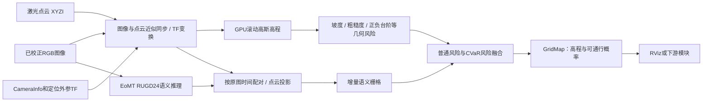

# RoadRunner_Project：项目整体介绍

RoadRunner_Project 将激光点云和相机图像转换为**局部高程地图与可通行概率地图**，供 RViz 显示或下游模块订阅。工程包含 GPU 高斯高程建图、地图生命周期管理、几何风险、EoMT 图像语义和时空语义融合。

只有一个 ROS 包、一份建图 YAML 和一个算法 launch。当前已经用 GOOSE rosbag 验证，不包含定位建图 SLAM、全局规划、MPPI 或车辆控制。

| 文档 | 解决什么问题 |
|---|---|
| [部署说明](部署说明.md) | 准备容器、模型、数据和编译环境，迁移到另一台 Linux 电脑 |
| [启动说明](启动说明.md) | 部署完成后，按最少步骤启动、回放和停止 |
| 本文 | 理解算法流程、输入输出、配置和目录 |

## 下载镜像与模型

首次部署可下载以下文件，运行环境和模型权重通过百度网盘单独提供：

| 文件 | 下载地址 | 提取码 | 大小 |
|---|---|---|---|
| Docker镜像 `roadrunner_mapping_image_20261023.tar.gz` | [百度网盘：运行环境](https://pan.baidu.com/s/1VblVwzpDR5stwx6IuSzO8w?pwd=wysq) | `wysq` | 约7.77GiB |
| EoMT/RUGD24语义模型 | [百度网盘：模型文件](https://pan.baidu.com/s/1st34fEGJRn0ozoGuhia0aw?pwd=nscn) | `nscn` | 三个模型文件共约1.18GiB |

镜像用 `docker load -i roadrunner_mapping_image_20261023.tar.gz` 导入，镜像名为 `roadrunner-mapping:20261023`；下载文件可用[镜像SHA256清单](docker/roadrunner_mapping_image_20261023.tar.gz.sha256)校验。

模型解压或复制到工程的 `models/eomt_rugd24/`，该目录必须包含 `config.json`、`preprocessor_config.json` 和 `model.safetensors`，用[模型SHA256清单](src/roadrunner_mapping/config/eomt_rugd_model.sha256)校验。镜像提供运行依赖，源码通过本仓库获取，模型和GOOSE测试bag分别准备。

下载后按[部署说明](部署说明.md)完成校验、创建容器和编译，再按[启动说明](启动说明.md)运行。

## 1. 整体流程



几何与语义异步运行：几何使用最新同步数据更新，不等待当前图像的语义推理；语义结果到达后，按原始时间配对点云并投影、累积。处理不及时会替换待处理旧帧，优先控制延迟。关闭语义后，原图像/点云同步输入要求仍然保留。

## 2. 输入话题

下面是唯一配置文件 [mapping.yaml](src/roadrunner_mapping/config/mapping.yaml) 的默认值。接其他传感器时改同一份文件。

| 话题 | ROS 类型 | 内容与要求 |
|---|---|---|
| `/sensor/lidar/vls128_roof/velodyne_points` | `sensor_msgs/PointCloud2` | 雷达坐标系点云，必须有数值字段 `x/y/z/intensity`；正确填写采集时间和 frame_id |
| `/sensor/camera/windshield/vis/image_rect_color` | `sensor_msgs/Image` | 已校正的 RGB 图像，支持 `rgb8/bgr8`；保留真实采集时间 |
| `/sensor/camera/windshield/vis/camera_info` | `sensor_msgs/CameraInfo` | 与图像尺寸、投影矩阵 P、ROI 和 binning 一致的相机标定 |
| `/tf`、`/tf_static` | `tf2_msgs/TFMessage` | 定位及传感器外参；必须能够查询输入时间对应的变换 |
| `/clock` | `rosgraph_msgs/Clock` | bag 模式的仿真时钟，由 `rosbag play --clock` 提供 |

默认世界坐标系为 `utm`，车体及输出坐标系为 `base_link`，雷达/相机为 `sensor/lidar/vls128_roof`、`sensor/camera/windshield/vis`。需要连通世界、车体、雷达和相机 TF 链；GOOSE 包已经提供，本工程不会自行估计车辆位姿。

图像与点云默认近似同步容差为0.08秒。实际传感器需要统一时间基准和正确外参；默认 `scan_deskew_mode: auto` 针对 GOOSE 的组织化 VLS128 布局估计扫描时序，换雷达时须核对或先设 `off`。

## 3. 输出话题

默认节点名为 `/roadrunner` 和 `/roadrunner_semantic`。高程/概率地图建议直接订阅前两项 GridMap。

| 话题 | ROS 类型 | 含义 |
|---|---|---|
| `/roadrunner/traversability_probability` | `grid_map_msgs/GridMap` | 普通风险融合后的高程与可通行概率地图 |
| `/roadrunner/cvar_traversability_probability` | `grid_map_msgs/GridMap` | 使用风险分布危险尾部统计的 CVaR 分支，通常更保守 |
| `/roadrunner/elevation` | `sensor_msgs/Image`，`32FC1` | 米制高程矩阵，几何未知处为 NaN |
| `/roadrunner/confidence` | `sensor_msgs/Image`，`32FC1` | 最终融合结果的可靠度，区别于可通行概率 |
| `/roadrunner/traversability_risk` | `sensor_msgs/Image`，`32FC1` | 普通融合风险，值越大风险越高 |
| `/roadrunner/cvar_traversability_risk` | `sensor_msgs/Image`，`32FC1` | CVaR 融合风险 |
| `/roadrunner/geometry_risk_std` | `sensor_msgs/Image`，`32FC1` | 几何风险分布的标准差 |
| `/roadrunner/geometry_risk_cvar` | `sensor_msgs/Image`，`32FC1` | 几何风险分布的 CVaR 值 |
| `/roadrunner/semantic_risk_std` | `sensor_msgs/Image`，`32FC1` | 语义风险分布的标准差 |
| `/roadrunner/semantic_risk_cvar` | `sensor_msgs/Image`，`32FC1` | 语义风险分布的 CVaR 值 |
| `/roadrunner/diagnostics` | `diagnostic_msgs/DiagnosticArray` | 输入/处理/丢弃/失败计数、语义融合计数、各阶段耗时、发布频率和健康状态 |
| `/roadrunner_semantic/prediction` | `roadrunner_mapping/EomtSemanticPrediction` | 同一图像的标签、置信度、原始 header 和推理耗时 |
| `/roadrunner_semantic/ready` | `std_msgs/Bool`，latched | 模型成功加载后发布 true；仅表示就绪，不代表正在收到数据 |
| `/roadrunner_semantic/diagnostics` | `diagnostic_msgs/DiagnosticArray` | 推理数、失败数、替换帧数、推理耗时和注意力后端 |

只有设置 `publish_world_map: true` 才发布 `/roadrunner/world_traversability_probability` 和 `/roadrunner/world_cvar_traversability_probability`，类型为 GridMap，默认最大1Hz。它们显示内部世界系滚动概率图，不是持久全局地图，也没有导航目标规划功能。普通分支相关话题取决于 `publish_legacy_probability`，默认开启。

两个局部 GridMap 均包含以下图层，并共用时间戳、位姿、范围和分辨率：

| 图层 | 单位/范围 | 如何理解 |
|---|---|---|
| `elevation` | 米 | 当前 `base_link` 车体系的 Z，不能当作海拔 |
| `geometry_probability` | 0～1 | 由地形几何风险转换的可通行程度 |
| `semantic_probability` | 0～1 | 由图像语义累积风险转换的可通行程度 |
| `final_probability` | 0～1 | 几何与语义融合结果，1风险低、0风险高 |

概率使用 `1-risk`，未知为 NaN；它是算法给出的通行评分，不能等同于统计校准后的安全保证。GridMap 高程只在几何有效格有值；语义可以在其他格有证据，因此有限概率不一定伴随有效高程。不要把未知高程填成0，也不要把未知概率默认当作可通行。

RViz 默认固定坐标系 `base_link`，高度选 `elevation`，颜色选 `final_probability`，红色风险高、绿色风险低。启用 `Metric Elevation` 可单独按高程着色。Image 按 height×width 的行序编码，保留内部 BEV 行列方向；GridMap 图层采用列主序。外部程序需要地图分辨率/位姿时应订阅 GridMap，不能直接套 OccupancyGrid 翻转规则。

## 4. 语义模块

当前后端为 **EoMT + RUGD24 本地权重**，不是 GOOSE 标注真值或 BeamNG 资源语义。24类包括泥土、沙、草、树、杆、水、天空、车辆、通用物体、沥青、砾石、建筑、覆盖物、碎石地、原木、自行车、行人、围栏、灌木、标志、岩石、桥、混凝土、野餐桌。

`EomtSemanticPrediction.labels` 为 `mono8`，类别 ID 是0～23；`confidence` 为 `32FC1`，与原图同尺寸，用来判断标签有效性。类别0是 dirt，不是 void。完整类别顺序及初始风险定义见 [semantic_profiles.py](src/roadrunner_mapping/roadrunner_mapping/semantics/semantic_profiles.py)。标签投影到点云后再更新语义地图，不直接把整张二维分割图当作三维地图。

默认推理上限2Hz，与几何地图频率分开。`/roadrunner_semantic/start_saving`、`/roadrunner_semantic/stop_saving` 为 `std_srvs/Trigger` 服务，可控制保存语义结果，默认不保存。

## 5. 常用参数

所有算法参数在 [mapping.yaml](src/roadrunner_mapping/config/mapping.yaml)，两个节点共用；修改后重启算法生效，不支持 `rosparam set` 热切换。

| 参数 | 默认值/作用 |
|---|---|
| `map_length_x_m / map_length_y_m / map_resolution_m` | 40m × 40m、0.2m/格；输出200×200格 |
| `world_map_length_m` | 内部滚动图80m；扩大输出范围时同步检查该值 |
| `minimum_range / maximum_range` | 点云距离过滤1.5～120m |
| `world_frame / base_frame / lidar_frame / camera_frame / output_frame` | 定位、传感器与输出坐标系 |
| `enable_elevation_map_lifecycle` | true；地图生命周期总开关 |
| `enable_visibility_cleanup` | true；用射线穿透证据逐步清除过时高程 |
| `enable_upper_bound` | true；用射线给未知地表建立高度上限，辅助落差风险判断 |
| `max_inference_hz` | 2.0；独立语义节点的推理上限 |
| `model_directory / hash_manifest` | 本工程模型目录及SHA256清单 |
| `risk_cvar_alpha` | 0.8；CVaR统计最危险的上尾部分 |

可见性清理与高度上界可以独立开启。两项同时设为 false 会跳过射线采样和可见性更新，保留真实高程融合、观测有效度刷新及其他生命周期功能。关闭清理后旧高度可能保留更久，关闭上界会减少落差判断证据。详见 [开关说明](docs/可见性与高度上界开关.md)。

时钟、是否启动语义与RViz通过 launch 参数控制：`./scripts/run.bash use_sim_time:=false` 用于实车时间，`enable_semantic:=false` 用于几何对照，`rviz:=true` 可随算法启动显示。launch 默认启用语义，其 `enable_semantic` 参数会覆盖同名 YAML 项，关闭语义应在启动命令中传参。

## 6. 目录与阅读顺序

```text
RoadRunner_Project/
├── README.md                    # 项目整体介绍
├── 部署说明.md                   # 依赖、容器/模型迁移与编译
├── 启动说明.md                   # 最少启动和停止操作
├── scripts/                     # 当前容器环境的构建、启动、回放及验证入口
├── docker/                      # 公开基础镜像的Dockerfile、运行依赖与隔离验证工具
├── src/roadrunner_mapping/       # 唯一ROS包
│   ├── scripts/                 # mapping_node.py、semantic_node.py、语义环境启动器
│   ├── roadrunner_mapping/
│   │   ├── geometry/            # 高斯高程、GPU滚动、生命周期、坡度/粗糙度/台阶风险
│   │   ├── online/              # GPU点云、增量语义、风险统计、异步缓存与融合
│   │   ├── sensors/             # 点云字段解码、标定与轨迹工具
│   │   └── semantics/           # EoMT运行、类别/风险、后处理与消息契约
│   ├── config/mapping.yaml      # 唯一算法参数文件
│   ├── config/mapping.rviz      # RViz显示配置
│   ├── config/*.sha256          # 语义权重校验清单
│   ├── launch/mapping.launch    # 统一算法launch
│   ├── msg/                    # 自定义语义预测消息
│   └── tests/                  # 核心算法及接口回归
├── env/                         # 已验证的Python依赖与语义版本锁
├── docs/                        # 迁移来源、设计与功能记录
├── reports/                     # 构建、回归、实包及性能验证证据
├── models/eomt_rugd24/           # 本地权重，单独提供，不入Git
├── build/、devel/               # 本机编译生成，不入Git
└── logs/、outputs/、.cache/      # 运行日志、结果、缓存，不入Git
```

建议先看 `config/mapping.yaml` 确认输入与功能，再看 `scripts/mapping_node.py` 理解同步/TF/异步编排；深入算法看 `geometry/gpu_rolling_elevation.py`、`geometry/elevation_map_lifecycle.py` 和 `online/online_fusion.py`。语义入口是 `scripts/semantic_node.py`。

| 脚本（位于scripts/） | 用途 |
|---|---|
| `build_docker.bash` | 从公开CUDA基础镜像构建ROS/几何/语义环境 |
| `create_container.bash` | 配置GPU、工程挂载和桌面授权，创建运行容器 |
| `verify_docker.bash` | 临时容器内全新构建、GPU/回归检查，可选GOOSE实包验收 |
| `build.bash` | 在现有容器内catkin编译，生成本工程消息与devel |
| `ros.bash / container_env.bash` | 使用ROS Noetic与本工程overlay，隔离旧工作区 |
| `run.bash` | 前台运行统一算法launch |
| `start.bash / stop.bash` | 可选的tmux后台管理方式；日常普通终端启动见[启动说明](启动说明.md) |
| `play_goose.bash` | 发布时钟并回放必要的图像、点云、内参及TF话题 |
| `verify_bag.py` | 在回放时检查真实输入、地图、语义、范围与失败计数 |

表中脚本均位于 `scripts/`。默认ROS master为 `http://127.0.0.1:11423`，容器名为 `roadrunner_bevfusion_container`。宿主可以使用ROS2，以上脚本实际在容器里加载ROS1 Noetic。

## 7. 已验证的结果与边界

- 独立Docker镜像：从公开CUDA基础构建后，全新catkin编译、649项回归、两环境GPU/ROS及GOOSE实际语义建图通过，见[Docker镜像验证](reports/Docker镜像验证.md)。模型与bag单独挂载，无需旧容器。
- 核心回归：649通过、1项几何环境可选Transformers用例跳过；该处理器用例已在独立语义环境直接执行通过。
- GOOSE实包：实际图像/点云/TF输入、EoMT推理、语义融合、高程与两路概率GridMap及RViz显示通过。
- 当前硬件为RTX 4060 Laptop 8GB。前序环境在同段GOOSE、40m/.2m、语义及RViz开启、1倍速条件下，预热5秒统计25秒：两项可见性功能开启约2.35Hz，同时关闭约6.67Hz，语义约2Hz。这是短片段地图发布频率，区别于RViz渲染帧率；新Docker镜像未重测此性能对比。

证据见 [验收记录](reports/验收记录.md)、[帧率对比](reports/可见性开关帧率对比.md)和[RViz截图](reports/rviz-goose.png)。不同数据域的语义精度、完整bag长期性能及真实车辆闭环尚未验收。

核心来源为原 RoadRunner `main / 451961a` 的在线代码；新工程独立存放运行源码、消息及模型，不依赖原工程源码路径。逐文件来源和后续可选分支改动见 [迁移清单](reports/migration_manifest.json)。
